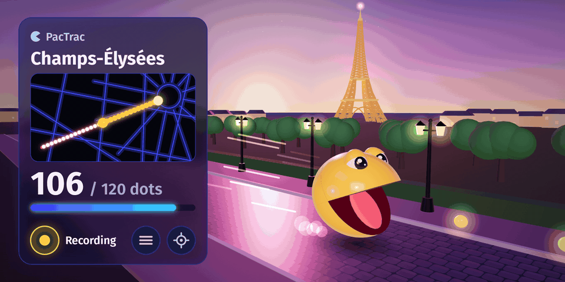
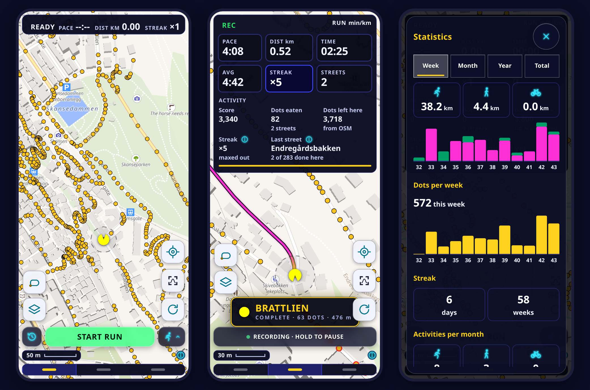
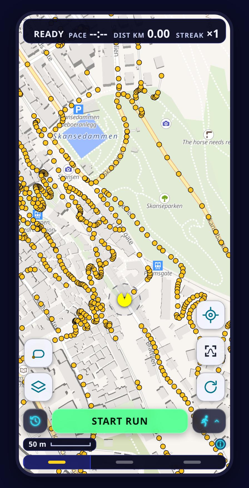
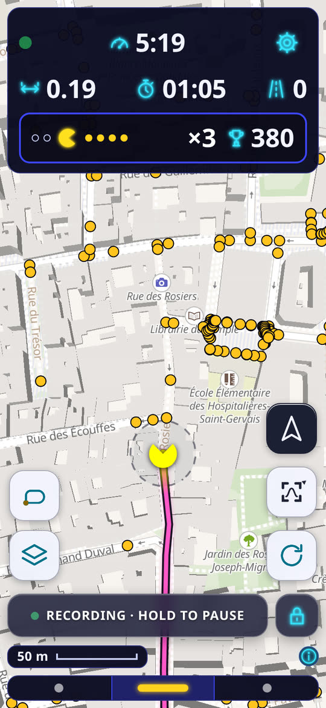
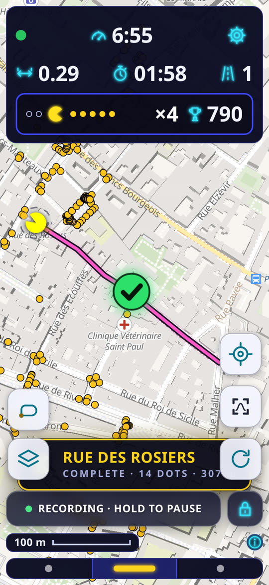
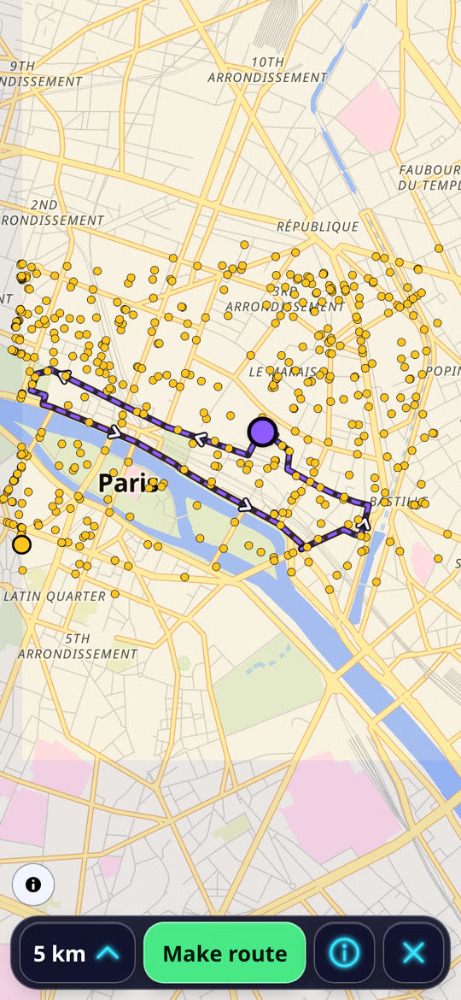
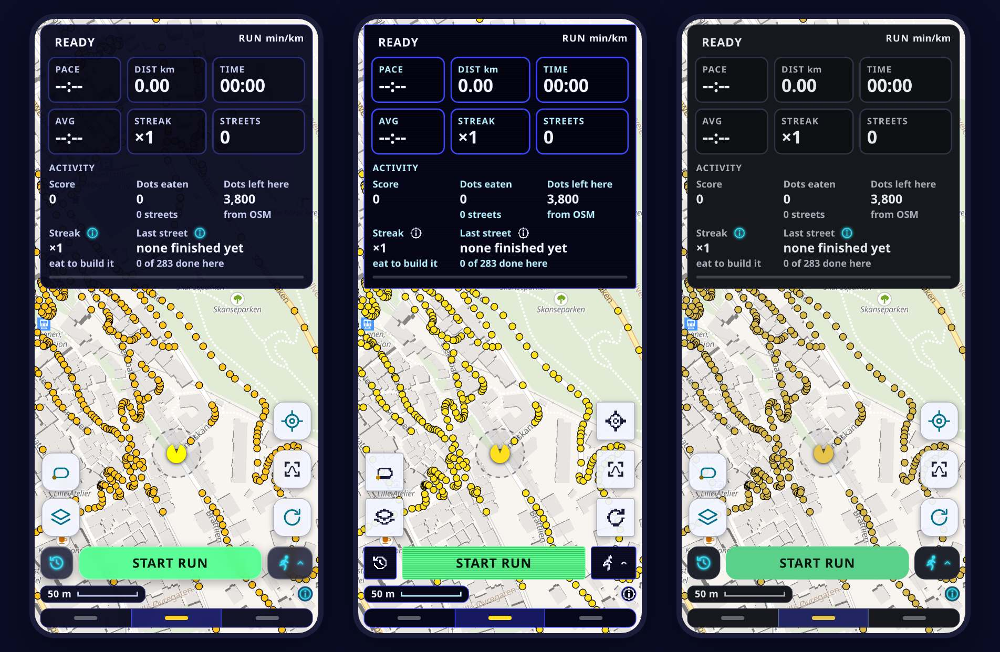

  

<h1 align="center">PacTrac</h1>

An Android app for running every street in town. Streets not yet run show as dots on the map, and running past a dot eats it.

  

<i>Screens from the app, with demo data from Paris.</i>

## A town full of dots

Every street still to run shows as a row of dots.

 

## The map empties behind every step

Dots on the trail disappear and the score counts up. Eating dots in a row raises the streak multiplier to at most ×5.

 

## Street complete

A finished street, zoomed and checked.

 

## Your numbers, at a glance

Three pages: Map focus, Mixed and Activity data. Settings → Fields sets which numbers each page shows, by drag and drop.

## Numbers to beat

Statistics show distance, dots eaten, streaks and activities per week, month, year and in total.

## One account, every phone

Signed in with a passkey, settings and finished activities sync between phones.

## Based on CityStrides

With a [CityStrides](https://citystrides.com) account connected, streets finished there show as finished in PacTrac.
PacTrac is an independent app, not an official CityStrides product.

## A route full of new streets

The route planner makes a round trip of a chosen length, a route through an area, or a route through chosen points, over as many unrun streets as possible.

 

## Pick a look

Three looks: CRT + 8-bit Pixel, Glass + Neon Cabinet and Calm + Neon Cabinet. High contrast gives light buttons with dark text for direct sun.

## Install on Android

1. Android 8 or newer is needed.
2. Download the `.apk` from the newest `android-` release under [Releases](../../releases), currently 0.36.0.
3. Open the file and allow installs from this source once.

The app updates itself from the same releases. Every release is signed with the certificate whose SHA-256 fingerprint ends in `8399`.
