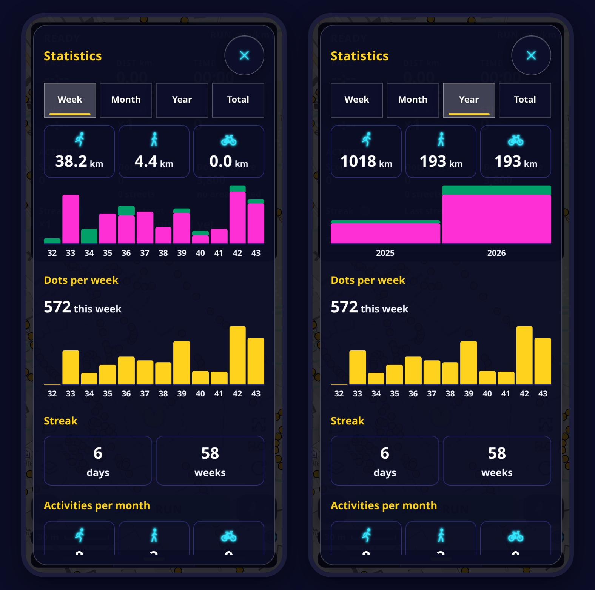
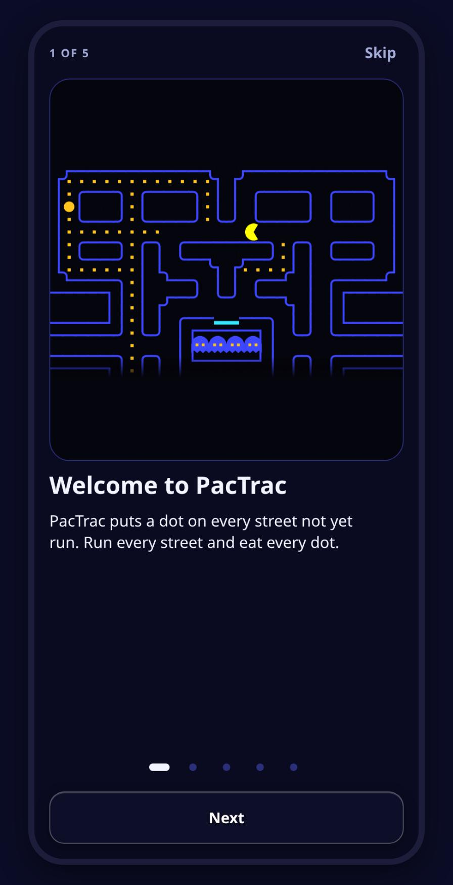

  

<h1 align="center">PacTrac</h1>

<b>Every street in town, one dot at a time.</b> 
Each street not yet covered becomes a trail of dots. Run or walk it, and the dots are gone. Waka waka.

  

<i>Real screens from the app, with demo data from Bergen.</i>

## A town full of dots

Open the map and every street still to cover glows with dots, from the high street to the narrowest alley.
A routine outing turns into a hunt. There is always one more street in sight.

 

## The map empties behind every step

Dots vanish underfoot and the score ticks up live.
Eat them in a row and the streak multiplier climbs to ×5. Red rings mark what is left of the current street, and the last dot swells into a power pellet.

 

## Street complete

Swallow the last dot and the street gets its name in lights: *Brattlien complete, 63 dots, 476 m.*
The panel tallies the streets finished on this outing and how many in the area are done.

 

## Numbers to beat

- **Distance** walked, run and ridden, per week, month and year, or in total.
- **Dots eaten** per week, for the last twelve weeks.
- **Streaks** in days and in weeks, and every one of them begs not to be broken.
- **Activities** per month, each one in the list carrying its score.

## Based on CityStrides

PacTrac is based on [CityStrides](https://citystrides.com) statistics, and CityStrides is the record of which streets are finished.
Connect a CityStrides account and the map shows that record: finished streets in white, the rest still waiting to be eaten.
City percentages and comparisons with others stay on CityStrides, one tap from the app.

PacTrac is an independent app, not an official CityStrides product.

## A route full of new streets

The route planner builds an outing that sweeps up as many uncovered streets as it can: a round trip from the door, a drawn area, or a line through chosen points.
Arrows point the way, and the phone buzzes before each turn.

## Pick a look

## More on the way

 

## Install on Android

1. Android 8 or newer is needed.
2. Open the newest `android-` release under [Releases](../../releases) on the phone and download the `.apk` file.
3. Open the file. Android asks once for permission to install apps from this source.

New versions arrive inside the app: it finds them and installs them itself.
A copy installed before the current signing key is refused as *App not installed*; remove it first, after exporting any activities worth keeping.

## This repository

Installable builds of PacTrac and nothing else. The source repository is private; this one is public so the app can check for and download its own updates.

| Platform | Tag | File |
|---|---|---|
| Android | `android-v<versionName>+<versionCode>` | `pactrac-android-v<versionName>.apk` |
| iOS | `ios-v<versionName>+<versionCode>` | `pactrac-ios-v<versionName>.ipa` |

The number after the `+` counts every build across both platforms, and the update check reads it.
Release notes list the issues closed since the previous release of the same platform; a release that lists nothing is still a real build.
